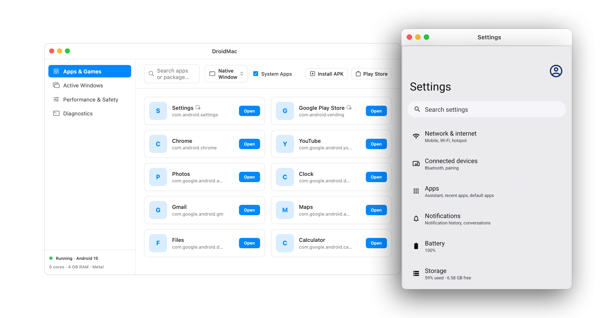
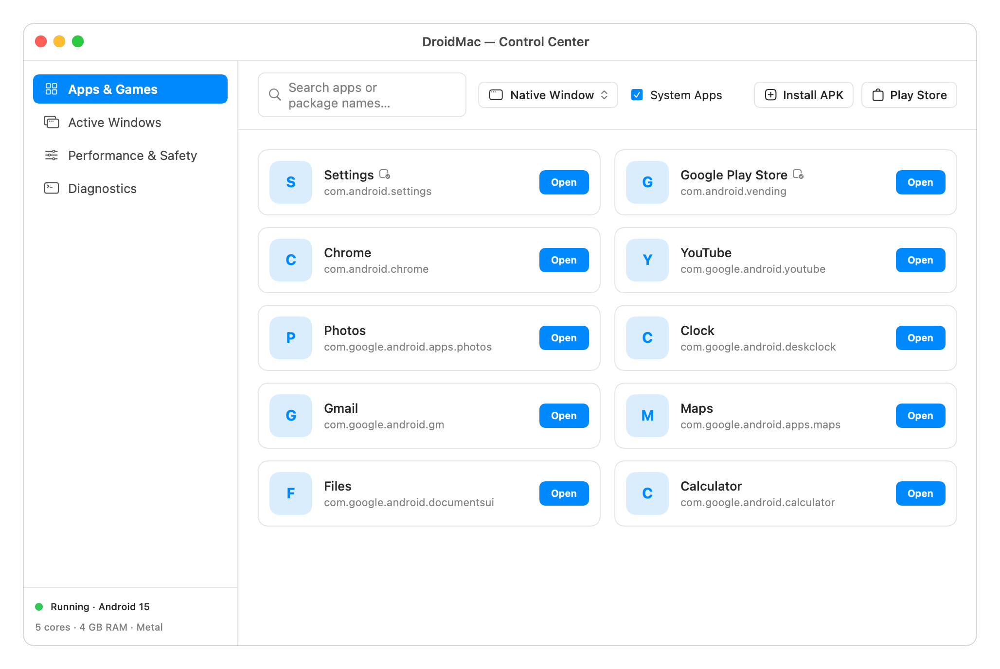
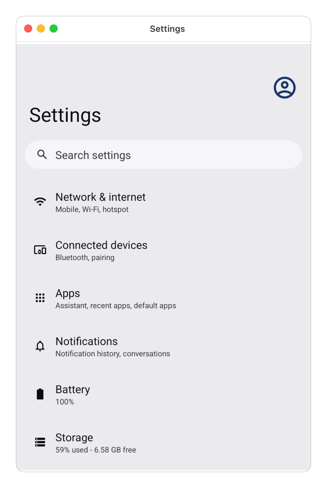
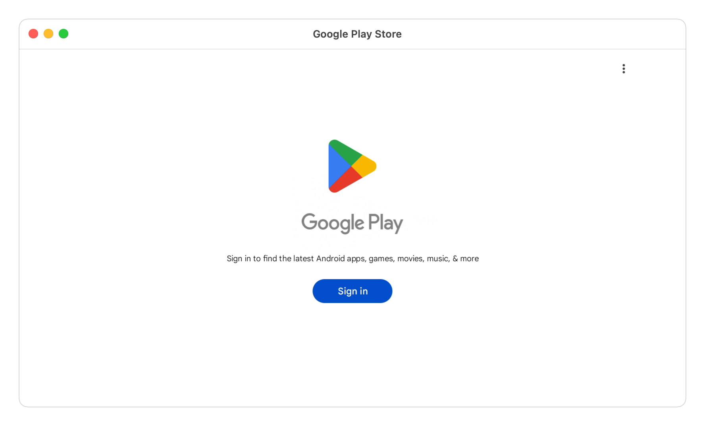
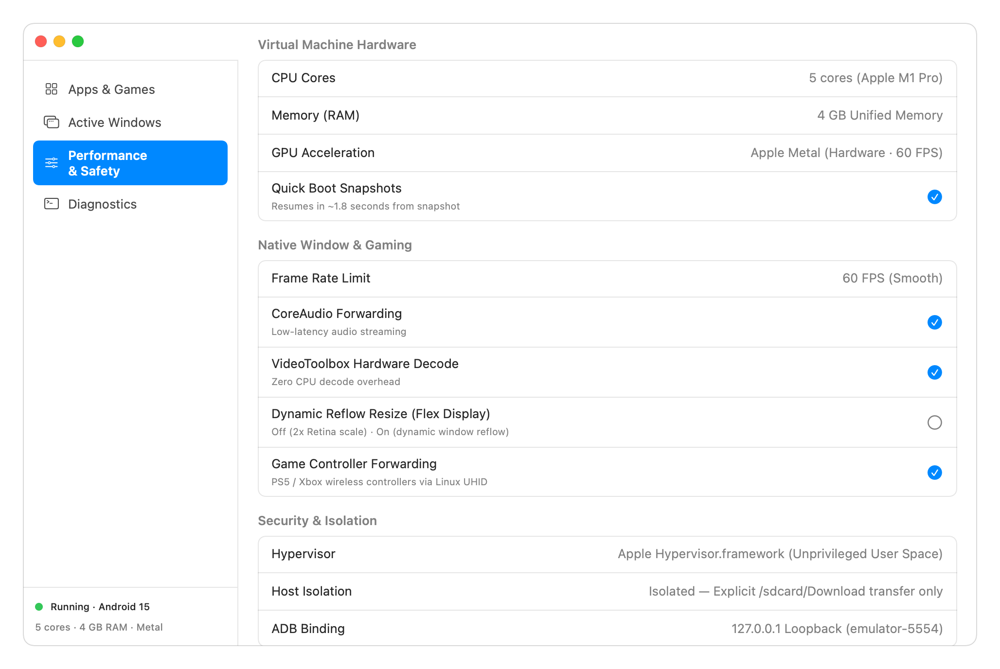

<p align="center">
  
</p>

<h1 align="center">DroidMac</h1>

<p align="center">
  <strong>Run Android apps and 3D games on Apple Silicon macOS as seamless native windows and standalone macOS applications.</strong>
</p>

<p align="center">
  <a href="https://github.com/sinarahmany/DroidMac/releases/tag/v1.0.0"></a>
  
  
  
  
  <a href="#license"></a>
</p>

---

## Downloads (v1.0.0)

| Package | Architecture | Size | Checksum (SHA-256) |
| :--- | :--- | :--- | :--- |
| **[DroidMac-v1.0.0-arm64.dmg](https://github.com/sinarahmany/DroidMac/releases/download/v1.0.0/DroidMac-v1.0.0-arm64.dmg)** | Apple Silicon (`arm64`) | `1.4 MB` | `0574f13f4188d0052c80f8c7766103fd2ba8dda203b13ad79d627fb2735bce62` |
| **[DroidMac-v1.0.0-arm64.zip](https://github.com/sinarahmany/DroidMac/releases/download/v1.0.0/DroidMac-v1.0.0-arm64.zip)** | Apple Silicon (`arm64`) | `1.0 MB` | `03494e7a4df339dc7fafb27fa332449010d1cc9c7b52e35e99cba19fc4690d81` |

> [!NOTE]
> All releases require macOS 13.0 or higher running on Apple Silicon (M1/M2/M3/M4, Pro, Max, or Ultra).

---

## One-Line Terminal Install

You can install DroidMac and all required runtime dependencies automatically via Terminal:

```bash
curl -fsSL https://raw.githubusercontent.com/sinarahmany/DroidMac/main/Scripts/install.sh | bash
```

The script verifies Homebrew dependencies (`scrcpy`, `android-platform-tools`), builds `DroidMac.app`, installs it to `~/Applications/DroidMac.app`, and configures the CLI utility.

---

## Showcase & Screenshots

### 1. Control Center & App Library
Manage installed apps, drag-and-drop APK installers, monitor VM status, and launch standalone app windows with one click.

<p align="center">
  
</p>

### 2. Standalone Per-App Windows
Android apps run inside authentic macOS windows with native title bars, Retina scaling, and keyboard/mouse passthrough.

<p align="center">
  &nbsp;&nbsp;&nbsp;&nbsp;
  
</p>

### 3. Engine & Performance Configuration
Fine-tune CPU core allocation, RAM limits, display density, Metal GPU translation, and secure sandbox options.

<p align="center">
  
</p>

---

## Key Highlights

- **Native Apple Silicon Execution:** Guest Android `arm64-v8a` instructions run directly on physical M-series CPU cores via Apple's `Hypervisor.framework`. Zero binary translation, maximum battery efficiency.
- **Metal 3D GPU Passthrough:** Guest Vulkan 1.4 and OpenGL ES 3.2 calls stream directly through `gfxstream` into Apple Silicon Metal shaders for rock-solid 60 FPS in games and animations.
- **Per-App Window Isolation:** Creates virtual Android secondary displays (`scrcpy` v5 + SDL3 + VideoToolbox hardware decode) so each app appears in its own independent, resizable macOS window rather than a clunky tablet frame.
- **Mac App Wrapper:** Export any installed Android app or game into a true macOS `.app` bundle stored in `~/Applications/DroidMac Apps/`. Open them directly from Spotlight, Launchpad, or the macOS Dock.
- **Strict Security & Privacy:** Runs without `sudo`, without kernel extensions, and without modifying macOS SIP. ADB binds exclusively to local loopback (`127.0.0.1:5554`), and APK archives are verified before installation.
- **Automated Teardown:** Quitting the Control Center gracefully snapshots and halts the Android VM in the background, freeing all host RAM and CPU threads.

---

## Comparison

| Capability | DroidMac | Standard Android Studio AVD | Legacy Emulators (BlueStacks, Nox) |
| :--- | :---: | :---: | :---: |
| **Apple Silicon Native** | Yes (Pure ARM64) | Yes | Emulated x86 or slow |
| **Per-App Native Windows** | Yes (Independent) | No (Entire phone frame) | No (Single heavy container) |
| **Export to macOS `.app`** | Yes (Spotlight / Dock) | No | No |
| **Retina 2x Crisp Text** | Yes | Variable | Blurry |
| **Metal GPU Passthrough** | Yes (`gfxstream`) | Yes | Software / OpenGL 2.1 |
| **Rootless / No Kexts** | Yes (Zero `sudo`) | Yes | Requires system privileges |

---

## Command Line Interface (`DroidMacCLI`)

DroidMac includes a high-performance CLI tool installed at `~/Library/Application Support/DroidMac/bin/DroidMacCLI`:

```bash
CLI="$HOME/Library/Application Support/DroidMac/bin/DroidMacCLI"

# Check engine and environment health
"$CLI" status

# Download and initialize isolated Android 15 SDK
"$CLI" setup

# Boot the headless ARM64 emulator engine
"$CLI" start

# List installed Android applications
"$CLI" apps

# Sideload an APK or XAPK
"$CLI" install /path/to/app.apk

# Launch an app in its own native macOS window
"$CLI" launch --package com.android.settings --profile adaptive --title "Settings"

# Wrap an app into a macOS .app bundle
"$CLI" wrap --package com.android.vending --name "Play Store" --profile game

# Safely stop the engine
"$CLI" stop
```

---

## Architecture

```
+--------------------------------------------------------------+
|                         macOS Host                           |
|                                                              |
|  +--------------------+        +--------------------------+  |
|  | DroidMac.app       |        | Native App Windows       |  |
|  | (SwiftUI Control)  |        | (scrcpy 5 + SDL3 + VT)   |  |
|  +---------+----------+        +-------------+------------+  |
|            |                                 |               |
|            | ADB loopback (127.0.0.1:5554)   |               |
|            v                                 v               |
|  +--------------------------------------------------------+  |
|  |       Headless Android VM (qemu-system-aarch64)        |  |
|  |   - Apple Hypervisor.framework (Native ARM64 Cores)    |  |
|  |   - Metal Hardware Accelerated GPU (gfxstream)         |  |
|  +--------------------------------------------------------+  |
+--------------------------------------------------------------+
```

---

## Manual Build & Development

Requirements:
- macOS 13.0 or later on Apple Silicon
- Xcode 15+ or Command Line Tools (`swift --version` >= 6.0)
- Homebrew: `brew install scrcpy android-platform-tools`

### Building the App
```bash
./Scripts/build_app.sh
```

### Packaging Distribution (.dmg & .zip)
```bash
./Scripts/package_release.sh 1.0.0
```

### Running Test Suite
```bash
swift test --parallel
```

---

## License

This project is licensed under the MIT License. See the [LICENSE](LICENSE) file for details.
